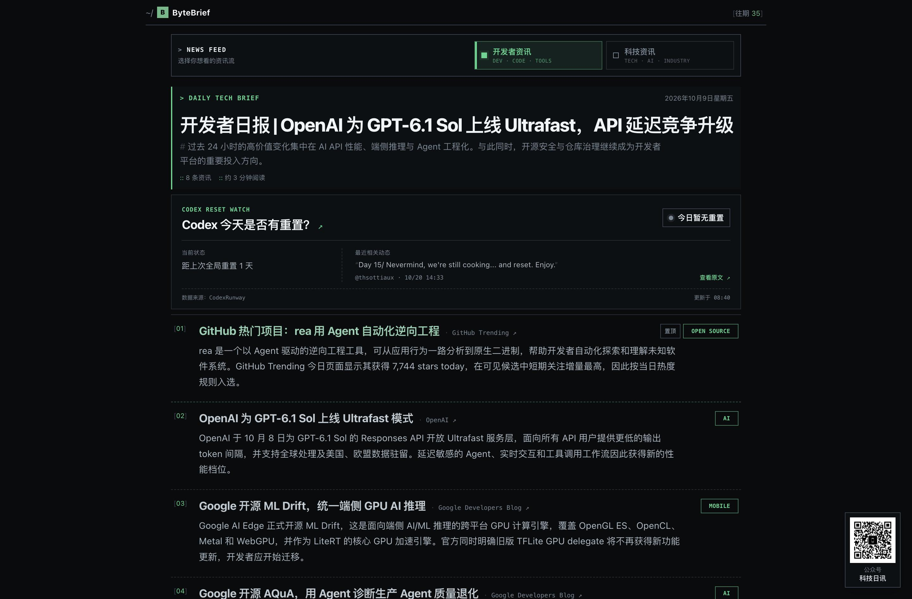

# ByteBrief｜每日科技速览

使用 **Next.js、React、TypeScript 与 Supabase** 构建的科技简报阅读站，提供开发者资讯和科技资讯两类内容，支持按日期回看往期简报。

[在线阅读](https://killenmr.github.io/bytebrief/) · [往期归档](https://killenmr.github.io/bytebrief/archive/)



## 功能

- **双资讯流：** 切换开发者资讯与科技资讯，并通过 URL Hash 保留当前选择。
- **结构化阅读：** 展示每日标题、导读、资讯摘要、分类标签及来源链接。
- **往期归档：** 按日期查看已发布简报，支持独立日期页面。
- **发布状态筛选：** 页面查询已发布内容，并按指定顺序组织资讯。
- **响应式界面：** 提供适配不同屏幕的阅读布局。

## 实现方式

首页并行获取两类最新简报；服务端读取 Supabase REST API，将简报元数据与资讯条目组合为阅读页面。交互组件负责资讯流切换，通用阅读组件复用于首页及日期详情页。

支持两种部署模式：默认 Next.js 模式使用 300 秒数据重验证；GitHub Pages 模式在构建时读取数据并静态导出，通过 GitHub Actions 重建和发布。资讯采集与内容生产由外部流程完成，本仓库提供阅读站与发布配置。

## 本地运行

使用 Node.js 22 可与现有 GitHub Actions 构建环境保持一致。

1. 安装依赖：`npm ci`。
2. 复制 `.env.example` 为 `.env.local`，按文件说明填写数据源配置。
3. 启动开发环境：`npm run dev`。
4. 打开 `http://localhost:3000`。

| 配置项 | 用途 |
| --- | --- |
| `NEXT_PUBLIC_SUPABASE_URL` | Supabase 项目地址 |
| `NEXT_PUBLIC_SUPABASE_PUBLISHABLE_KEY` | 数据读取使用的 publishable key |
| `NEXT_PUBLIC_DEVELOPER_NEWS_PROJECT_ID` | 开发者资讯项目 ID，可选覆盖 |
| `NEXT_PUBLIC_TECH_NEWS_PROJECT_ID` | 科技资讯项目 ID，可选覆盖 |
| `NEXT_PUBLIC_WECHAT_QR_URL` | 公众号二维码图片地址，可选覆盖 |
| `NEXT_PUBLIC_WECHAT_ACCOUNT_URL` | 公众号跳转地址，可选 |

运行时需要可访问的数据源，包含 `tech_daily_digests` 与 `tech_news_items` 两张表；字段定义和查询条件见 [`lib/types.ts`](lib/types.ts) 与 [`lib/news.ts`](lib/news.ts)。

## 项目结构

```text
app/                       首页、归档页与日期详情页
components/                简报阅读、资讯流切换等组件
lib/                       数据查询、类型与文本处理
assets/                    图片资源
.github/workflows/pages.yml GitHub Pages 构建与发布
```

## 部署

### GitHub Pages

现有工作流在 `main` 分支推送、手动触发及定时任务时构建发布；定时任务目标为北京时间每日 06:20，实际执行时间由 GitHub 调度决定。

构建时设置 `GITHUB_PAGES=true`，启用静态导出和 `/bytebrief` 路径前缀，并将 `assets/` 复制到导出目录。静态页面内容随下次构建更新。

### Vercel

导入仓库，按上表配置环境变量，使用默认 Next.js 构建配置。此模式保持 `GITHUB_PAGES` 未设置。

## 常用命令

```bash
npm run dev
npm run build
npm start
```

`npm start` 用于默认 Next.js 模式的构建结果；GitHub Pages 使用静态导出产物。
